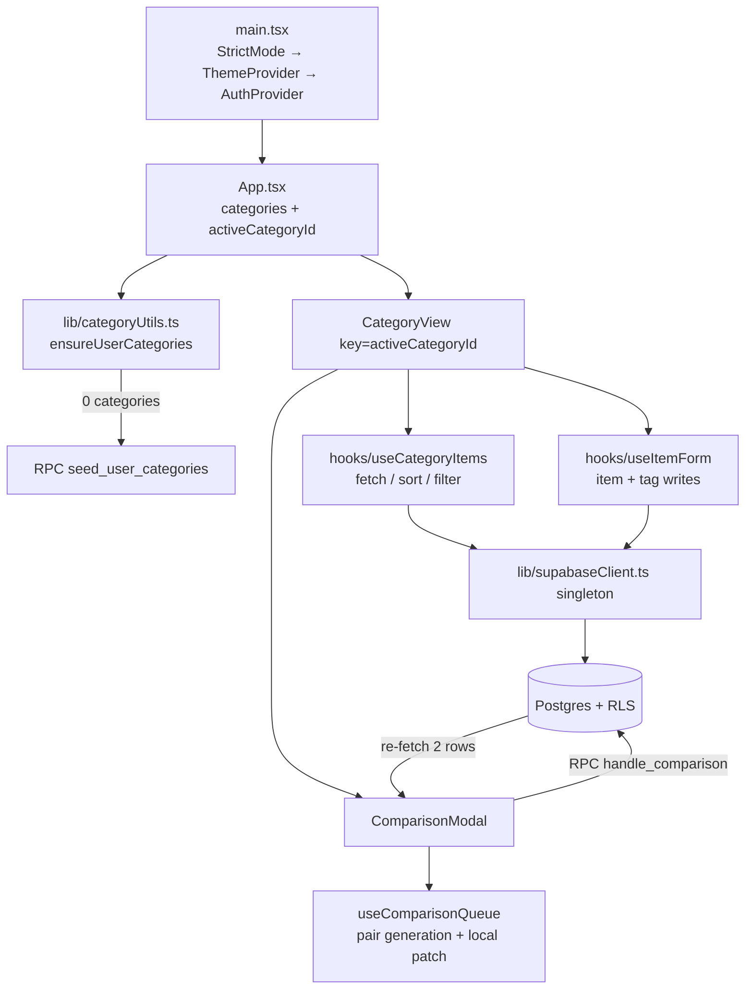

# Repository Guidelines

Orderly ("rankedreviews" in `package.json`) is a React 19 + TypeScript + Vite SPA backed by Supabase. Users create dynamic categories, log items, and rank them by **head-to-head comparison using Glicko-1** instead of star ratings.

> **Migration in progress.** This repo is moving from Supabase + Vercel to a Go modular monolith on a self-managed k3s VPS. Before migration work, read `docs/migration-plan.md` (phases, status, exit criteria), the relevant `docs/adr/` records, and `docs/workflow.md`. Start migration sessions with `/skill:phase-kickoff` and finish them with `/skill:phase-closeout`. The sections below describe the repo **as it is today**; keep them current as phases land.

## Project Overview

- **Purpose**: personal ranking of anything (movies, books, restaurants) with confidence-aware ratings (rating + RD), adaptive calibration, tags, custom category schemas, and list sharing.
- **Product rules**: every item belongs to a category definition; category fields are user-defined JSON; ratings are only changed by a Postgres RPC, never computed in TypeScript.
- **Auth**: anonymous Supabase sessions are created automatically; signing up links email/password to the existing anonymous user (`auth.updateUser`, not `signUp`).

## Architecture & Data Flow

- **No router.** `App.tsx` holds `activeCategoryId`; Sidebar selects a category; `<CategoryView key={activeCategory.id}>` force-remounts on switch, resetting child state. No URL/deep links.
- **Data access is direct, not layered.** The typed singleton in `src/lib/supabaseClient.ts` is imported everywhere. Queries live in hooks (`useCategoryItems`, `useItemForm`), in `lib/` helpers (`categoryUtils.ts`), and inline in components (`ComparisonModal`, `CategoryBuilder`, `CategoryManager`, `TagManager`, auth forms).
- **No cache / no React Query / no realtime.** Mutations refetch via callbacks (`getItems`, `refreshCategories`) or remounts. Comparison results are patched locally in `useComparisonQueue.updateRatings` after the RPC.
- **Rating authority is SQL.** `handle_comparison(p_winner_id, p_loser_id)` performs RD time decay, Glicko-1 updates, `comparison_count`, `last_compared_at`, and the `comparisons` audit insert. The client only calls the RPC and re-fetches `id, rating, rd`.
- **Pair selection is TypeScript.** `useComparisonQueue` builds a ≤100-pair queue (uncertain / similar / random tiers) and a 3-round calibration binary search with ±25% jitter. Input must be rating-descending.
- **Dynamic schema.** `category_definitions.field_definitions` (jsonb) holds `FieldDefinition[]`; per-item values live in `items.properties` (jsonb). Keys are immutable slugs generated from labels; labels are mutable. Global templates are rows with `user_id IS NULL`.

## Key Directories

| Path | Purpose |
|---|---|
| `src/components/` | Feature components grouped by domain: `items/`, `categories/`, `auth/`, `layout/`, `shared/` |
| `src/components/ui/` | Vendored shadcn/ui ("new-york") modules; direct imports, no barrel |
| `src/hooks/` | All stateful data logic: `useCategoryItems`, `useItemForm`, `useComparisonQueue`, `usePrevious` |
| `src/lib/` | Supabase client, `cn` + formatting helpers, category seeding/migration, Lucide icon map |
| `src/types/` | `types.ts` hand-written domain types; `database.types.ts` generated — do not hand-edit |
| `supabase/migrations/` | Additive SQL migrations; all DB functions, RLS policies, indexes |
| `src/contexts/` | `AuthContext` (anonymous bootstrap, session, sign-out) |
| `docs/` | README screenshots/ER diagram only |

## Development Commands

| Task | Command |
|---|---|
| Install | `npm install` (npm, `package-lock.json` v3) |
| Dev server | `npm run dev` (Vite, default port 5173) |
| Typecheck + production build | `npm run build` (`tsc -b && vite build`) |
| Preview build | `npm run preview` |
| Lint | `npm run lint` (`eslint .`) |
| Tests (watch) | `npm run test` |
| Tests (CI) | `npm run test:run` |
| Coverage | `npm run test:coverage` |
| Format | `npx prettier --write .` — **no `format` npm script exists** despite README |
| New migration | `npm run db:new <snake_case_name>` |
| Push migrations | `npm run db:push` (sources `.env.local`; requires linked project + CLI auth) |
| Migration status / diff | `npm run db:list`, `npm run db:diff` |
| Regenerate DB types | `npm run db:types` (hardcoded project ref `txfxxktbykqvmsuhrfez`) |

Required env in `.env.local` (gitignored): `VITE_SUPABASE_URL`, `VITE_SUPABASE_ANON_KEY`. The client throws if either is missing.

## Code Conventions & Common Patterns

**Language / formatting**
- TypeScript `strict`, `noUnusedLocals`, `noUnusedParameters`, `verbatimModuleSyntax` — use `import { type X }` for types.
- Prettier: 2 spaces, single quotes, width 120, LF, always arrow parens. Not enforced by lint.
- `simple-import-sort` is an **ESLint error**: external packages, blank line, `@/` imports, blank line, relative imports. Let `eslint --fix` reorder.
- Path alias `@/* → src/*` (both TS and Vite). Use `@/` across directories; relative imports for siblings.

**Components / hooks**
- Named exports everywhere; only `App.tsx` uses `export default`.
- One component per file; private subcomponents at the bottom of the same file (`ErrorState`, `ComparisonCard`, `FieldEditorRow`).
- Memoize leaf lists/components with `React.memo` where rerenders matter (`ItemCard`, `ItemForm`, `TagBadge`); use `useCallback`/`useMemo` for callbacks and derived arrays.
- Merge classes only with `cn()` from `@/lib/utils`. Theme tokens are CSS variables in `src/index.css`.
- Hooks return data + `loading`/`error` and a refresh callback; follow `useCategoryItems` as the template. Guard initialization with refs so parent rerenders do not reset forms (`useItemForm`).
- No form library, no schemas: plain `useState`; validation is ad hoc.

**Error handling**
- Mutations → `toast.success` / `toast.error` (sonner).
- Fetch/query → expose `error` and render an inline error state (`CategoryView`'s `ErrorState`).
- `lib/` helpers → throw (`ensureUserCategories`); auth forms → local inline error state.
- `console.error` only as a last resort; **`console.log`/`group*` are stripped by `vite-plugin-remove-console` in every mode** — use `warn`/`error` for debugging.

**Supabase**
- Import the singleton; never create additional clients.
- Filter `.eq('user_id', user.id)` on reads/writes where practical; RLS is the backstop, but a few paths (`CategoryManager` delete/reorder) rely on RLS alone.
- Generated `database.types.ts` types `field_definitions`/`properties` as `Json`; domain code uses `as unknown as CategoryDefinition` casts in `categoryUtils.ts`, `CategoryBuilder.tsx`, `TagManager.tsx`. Keep casts localized.
- Schema changes: new migration → `db:push` → `db:types` → update types/call sites. Never edit an applied migration. New tables need `ENABLE ROW LEVEL SECURITY` plus `auth.uid() = user_id` policies.
- `SECURITY DEFINER` functions bypass RLS: include an explicit ownership check when adding one (`handle_comparison` currently has none).

**Dynamic field changes — update all of these**
1. `src/types/types.ts` — `FieldType` union, `ItemPropertyValue`
2. `src/components/categories/CategoryBuilder.tsx` — `FIELD_TYPES` dropdown
3. `src/components/shared/DynamicFieldRenderer.tsx` — input branch
4. `src/lib/utils.ts` — `formatFieldValueAsText` (cards, sharing)
5. `src/components/items/ItemDetailsContent.tsx` — `renderPropertyValue`
6. `src/components/items/SortControls.tsx` — `TYPE_OPERATORS`, sortable allowlist
7. `src/hooks/useCategoryItems.ts` — server vs client filter/sort strategy

No SQL migration is needed for a field type; only for new columns/RPC signatures.

**Ranking changes**: edit `handle_comparison` in a new migration, keep the RPC contract stable, and update the duplicated confidence bands in `ItemCard.tsx`, `ItemDetailsContent.tsx`, `CategoryView.tsx` (RD <150 / <250 / >250) plus queue logic in `useComparisonQueue.ts` if pairing changes.

**Tags**: `TagInput` creates draft tags with negative IDs; `useItemForm.handleTagSync` persists them (case-insensitive reuse) and diffs `item_tags`.

## Important Files

| File | Why it matters |
|---|---|
| `src/main.tsx` | Provider stack + PWA service-worker registration |
| `src/App.tsx` | Shell, category selection, loading/empty states |
| `src/contexts/AuthContext.tsx` | Anonymous auth, session, `isPermanent`, sign-out |
| `src/lib/supabaseClient.ts` | Env validation and typed client |
| `src/lib/categoryUtils.ts` | Category fetch, seed RPC, legacy global-reference migration |
| `src/lib/utils.ts` | `cn`, property formatting, card detail extraction |
| `src/hooks/useCategoryItems.ts` | Server sorting/filtering + client-side numeric/tag filters |
| `src/hooks/useComparisonQueue.ts` | Pair generation, calibration, local rating patch |
| `src/components/items/ComparisonModal.tsx` | RPC invocation and post-comparison refetch |
| `src/components/categories/CategoryView.tsx` | Per-category dashboard orchestration |
| `src/components/shared/DynamicFieldRenderer.tsx` | Renders dynamic category fields |
| `src/types/types.ts` | Canonical domain model |
| `src/types/database.types.ts` | Generated Supabase types (regenerate, don't edit) |
| `supabase/migrations/20260101000000_initial_schema.sql` | Tables, enums, RLS enablement |
| `supabase/migrations/20260328201200_existing_functions_rls_indexes.sql` | Glicko RPC, seed RPC, policies, indexes |
| `supabase/migrations/20260401152602_add_category_sort_order.sql` | Current head (`sort_order`) |
| `vite.config.ts` | Aliases, PWA, console stripping, embedded Vitest config |
| `components.json` | shadcn aliases/style |

## Runtime/Tooling Preferences

- **Node**: `^20.19 || ^22.12 || >=24` implied by Vite 7 / Vitest 4 (`package.json` has no `engines`). **npm** is the package manager (lockfile v3); do not introduce pnpm/yarn artifacts.
- **React 19**, Vite 7, `@vitejs/plugin-react`, Tailwind **v4 CSS-first** (`@import 'tailwindcss'` + `@theme` in `src/index.css`). `tailwind.config.js` is not loaded (no `@config`) — put tokens/utilities in CSS. `autoprefixer` is unused.
- **UI**: Radix primitives via vendored shadcn components; `class-variance-authority` for variants; `lucide-react` icons. DB stores icon names resolved through `lib/icons.ts` + `DynamicIcon`.
- **PWA**: `vite-plugin-pwa` with `registerType: 'autoUpdate'`; manifest generated at build, no `public/manifest.json`. Service worker is registered in `main.tsx`.
- **Tooling caveats**: ESLint flat config ignores only `dist`; tests and `vite.config.ts` are linted. `tsc -b` type-checks tests too. Supabase local config expects `supabase/seed.sql`, which is absent; auth `site_url` is `127.0.0.1:3000` while Vite serves 5173.
- **Identity**: repo/package name is `rankedreviews`, product and Supabase project are `orderly`; do not "fix" this silently.

## Testing & QA

- **Framework**: Vitest 4, config embedded in `vite.config.ts` (`globals: true`, `environment: 'node'`). No setup files, no coverage thresholds; `@vitest/coverage-v8` is installed for `test:coverage`.
- **Scope today**: two colocated unit suites — `src/lib/utils.test.ts` (25 tests: formatting, card details) and `src/lib/categoryUtils.test.ts` (7 tests: seeding, ordering, migration, error paths). Hooks, components, context, and queue/calibration logic are untested.
- **Style**: plain `describe`/`it`/`expect`; inline fixture factories; mock Supabase with `vi.hoisted` + a thenable chain (`select/eq/in/is/order/update/single/delete`) and `vi.mock('@/lib/supabaseClient')`. No jsdom, Testing Library, or MSW — adding component tests requires new dev deps and a per-file `// @vitest-environment jsdom` docblock or config change.
- **Adding tests**: place `foo.test.ts` next to `foo.ts` in `src/lib/`, or alongside the hook/component for new coverage. Prefer pure-function tests for queue math, filters, and formatting.
- **Before yielding**: run `npm run lint`, `npm run test:run`, and `npm run build`. `npm run test:run` covers only `src/lib` today, so exercise changed UI flows manually (the app requires live Supabase creds).

## Known Inconsistencies (do not replicate)

- README documents `npm run format`; no such script. Use Prettier directly.
- `20260101000000_initial_schema.sql` uses unsupported `CREATE TYPE IF NOT EXISTS`; a fresh `db push` will fail at line 6 unless fixed in a new migration.
- `supabase/seed.sql` referenced by `config.toml` does not exist; default categories only seed when global (`user_id IS NULL`) template rows already exist in the database.
- `seed_user_categories` does not copy `sort_order`, so seeded categories all default to `0`.
- `handle_comparison` is `SECURITY DEFINER` without an ownership/`auth.uid()` check.
- Ranking constants (350/30 RD, 90-day decay, 150/250 bands) are duplicated across SQL and three components; there is no shared constants module.
- Unused exports: `SortOption`, `SupabaseMutationResponse`, `isAnonymous`, `calibrationRound`; `FieldDefinition.required` is never enforced.
