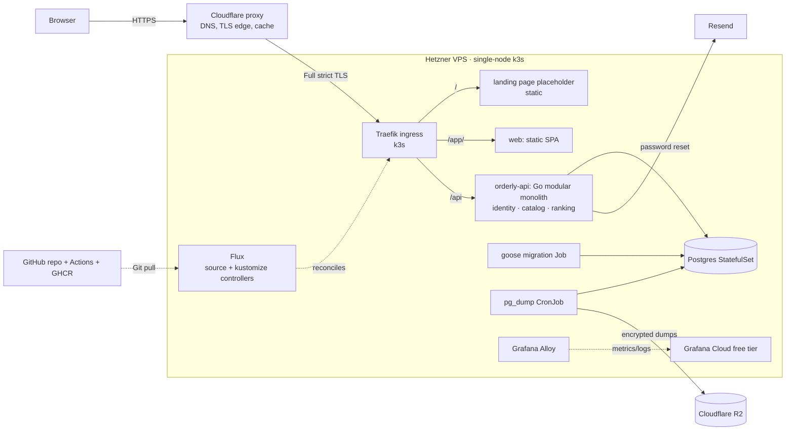

# Migration Plan: Supabase SPA → Go backend on a self-managed VPS

Status: **Phase 0 (planning) complete — Phase 1 next.**
Owner: Michael. Last updated: 2026-10-23.

This is the master plan. Every AI session working on the migration starts here; see [`workflow.md`](./workflow.md) for how to run those sessions. Decisions live in [`adr/`](./adr/README.md); this file holds the phases, their status, and open questions.

## Goals

- Move all data and business logic off Supabase onto a single VPS I operate.
- Learn Go backend development and single-node Kubernetes ops (k3s, Flux GitOps, Grafana Cloud).
- Shrink the frontend to UI plus typed API calls: ranking math, pair selection, filtering/sorting, tag syncing, and category seeding move to the server.
- Keep the app working at the end of every phase. No big-bang cutover.

## Non-goals (for now)

- Running multiple services from the start. Begin as a **modular monolith** ([ADR-0001](./adr/0001-modular-monolith.md)); splitting into services is optional and comes last.
- High availability or zero-downtime deploys. Downtime is acceptable; cheap matters more.
- A persistent staging environment ([ADR-0007](./adr/0007-no-persistent-staging.md)).
- Anonymous/guest users in the MVP. The data model is designed for them and they're implemented after the MVP ([ADR-0008](./adr/0008-anonymous-ready-identity.md)).
- Any post-MVP feature (see [Post-MVP backlog](#post-mvp-backlog-constraints-on-the-mvp)). The MVP only keeps the doors open that the backlog lists; it does not build these features.

## Target architecture



- **Same origin.** The landing page is at `/`, the SPA at `/app/`, and the API at `/api/`, all on one domain ([ADR-0009](./adr/0009-url-layout-landing-app-api.md)), so no CORS. Sessions use cookies (`HttpOnly`, `Secure`, `SameSite=Lax`) plus an `Origin` header check for CSRF.
- **Single node, single region.** Hetzner Hillsboro, OR (`hil`), roughly 25–40 ms from Southern California [INFERENCE; not measured]. Target size is 4 GB RAM. Full rationale in [ADR-0004](./adr/0004-single-vps-k3s-cloudflare.md).
- **The API contract is OpenAPI.** `api/openapi.yaml` is the source of truth:
  - Go server stubs are generated with `oapi-codegen`.
  - Frontend TypeScript types are generated with `openapi-typescript`. That tool emits types only (no runtime code), so it's paired with `openapi-fetch` to make the calls typed.
  - This replaces `src/types/database.types.ts` as the shared frontend/backend contract.

### Target repository layout

The SPA moves to `web/` in Phase 2. Until then it stays at the repo root.

```text
api/openapi.yaml            # API contract
backend/                    # Go module
  cmd/orderly/              # main: HTTP server
  cmd/migrate/              # goose runner (k8s Job entrypoint)
  internal/identity/        # users, sessions, password reset, (later) guests
  internal/catalog/         # categories, items, tags, filtering/sorting
  internal/ranking/         # Glicko-1, comparisons, pair queue, calibration
  internal/platform/        # config, db pool, logging, metrics, http middleware
  migrations/               # goose SQL/Go migrations (from Phase 6)
web/                        # React SPA (moved from repo root)
deploy/
  base/                     # Kustomize base: api, web, postgres, jobs
  overlays/prod/            # prod patches; staging overlay can be copied from this later
  flux/                     # Flux GitRepository + Kustomization objects
  secrets/                  # SOPS-encrypted secrets only
infra/                      # OpenTofu (hcloud, Cloudflare DNS) + cloud-init
docs/                       # this plan, ADRs, workflow, learning notes
```

Module boundaries:
- `catalog` and `ranking` may depend on `identity` only through an interface they define. They never depend on each other directly.
- Cross-module reads go through Go interfaces, not shared tables.
- This keeps a later service split mechanical.

## Phases

Each phase is one branch and one PR (or one per sub-step if a phase is large), merged into `main`. Each phase ends with **exit criteria**: things I can observe working, not just "the code compiles".

|#|Phase|Status|
|---|---|---|
|0|Planning docs, ADRs, workflow|✅ done|
|1|Infrastructure foundation|⬜ next|
|2|Go skeleton + CI/CD + repo restructure|⬜|
|3|Catalog API + frontend port|⬜|
|4|Ranking in Go|⬜|
|5|Own auth (sessions, Resend)|⬜|
|6|Data cutover to self-hosted Postgres|⬜|
|7|Hardening and observability|⬜|
|8|Anonymous guest users (post-MVP)|⬜|
|9|Optional: extract services|⬜|

**MVP = Phases 1–7.** That gives a fully self-hosted app with my own auth, no Supabase, and monitoring and backups.

### Phase 1: Infrastructure foundation

Bring up the server and the deploy pipeline while the app itself keeps using Supabase from the browser.

- Buy a domain on Cloudflare Registrar. Cloudflare DNS with the proxy on.
- OpenTofu in `infra/`: Hetzner server, firewall (SSH from my IP only; 80/443 from Cloudflare IP ranges only), and Cloudflare DNS records.
- cloud-init: non-root user, key-only SSH, unattended upgrades, fail2ban, then install k3s (bundled Traefik and local-path storage stay on).
- TLS between Cloudflare and Traefik, with Cloudflare SSL mode set to Full (strict). Choose between a Cloudflare Origin CA certificate stored as a Secret, or cert-manager with a DNS-01 challenge. Decide at kickoff.
- Flux bootstrap with only `source-controller` and `kustomize-controller`. SOPS + age for secrets ([ADR-0005](./adr/0005-gitops-flux-sops.md)).
- Grafana Alloy shipping node metrics and pod logs to Grafana Cloud, with metric filtering from day one to stay inside the free tier.
- Serve the current SPA from the cluster (nginx image built in CI and pushed to GHCR), then point the domain at it and disconnect Vercel.
- Add the new domain to Supabase Auth's Site URL and redirect URLs.

**Exit criteria:**
- `https://<domain>` serves the app, deployed by Flux from a Git commit.
- Logs and node metrics are visible in Grafana Cloud.
- Vercel is disconnected.
- `tofu destroy && tofu apply` plus Flux bootstrap rebuilds the box. Rehearse this once.

### Phase 2: Go skeleton, CI/CD, repo restructure

- Move the SPA into `web/` and fix the build, Vite config, ESLint, and CI paths.
- Serve the SPA under `/app/` (Vite `base`, PWA `scope` and `start_url`, Traefik routes, Supabase Auth Site URL and redirect URLs) with a placeholder at `/`, per [ADR-0009](./adr/0009-url-layout-landing-app-api.md). Check that an already-installed PWA picks up the new scope.
- Go module in `backend/`:
  - `net/http` server, `slog` JSON logs, Prometheus `/metrics`, `/healthz` and `/readyz` endpoints.
  - `pgx` connection pool and config from environment variables.
  - Graceful shutdown.
- `api/openapi.yaml` with a first endpoint (for example `GET /api/me`). Code generation for both sides, with CI failing if the generated code is out of date.
- Connect to Supabase Postgres through the **Supavisor session pooler**. It supports IPv4; Supabase's direct database host is IPv6-only unless you pay for the IPv4 add-on [verify against current Supabase docs].
- Auth during the transition: verify Supabase access tokens with the project's JWKS (`/auth/v1/.well-known/jwks.json`), or the legacy HS256 secret if the project hasn't migrated signing keys. The `sub` claim is the user ID.
- **The API connects with a database role that bypasses RLS, so every query must filter by `user_id`.** Add a test that proves user A cannot read user B's rows.
- GitHub Actions: path-filtered jobs, `golangci-lint`, `go test` (using `testcontainers-go`), multi-arch image build pushed to GHCR, then a commit of the new image tag into `deploy/overlays/prod`.

**Exit criteria:**
- Merging to `main` deploys a new API image via Flux with no manual steps.
- `GET /api/me` returns my user ID when called from the SPA with my Supabase session.

### Phase 3: Catalog API + frontend port

- Endpoints for categories (including builder and reorder), items (CRUD, server-side sort and filter across all field types), and tags (CRUD, plus attach/detach on an item in a single request).
- **Keep sort/filter extensible** so post-MVP location and search features add to it rather than rewrite it:
  - Sorting and filtering are a list of typed clauses (field, operator, value), handled by one handler per field type. Adding a type or operator is a new handler, not a change to every endpoint.
  - Room for a computed sort key in the request shape. Distance and the distance-vs-quality blend need inputs (the user's coordinates, a weight) that aren't columns.
- **Typed location values.** The `location` field type already exists in the frontend (`LocationValue { address, coordinates: { lat, lng } | null }`; the builder offers it; filtering is `contains` on the address only). The Go `catalog` module validates that shape on write and stores it unchanged. Geocoding and distance stay out of scope.
- Server-side replacements:
  - the client-side filtering in `useCategoryItems`
  - the tag diffing in `useItemForm.handleTagSync`
  - the `ensureUserCategories` seeding and legacy migration logic
  - the `seed_user_categories` and `get_tags_for_category` RPCs
- Frontend hooks become `openapi-fetch` calls. `supabase.from(...)` is removed everywhere except comparisons and auth.
- Port feature by feature (items → tags → categories) as separate PRs if that's easier.

**Exit criteria:**
- Every catalog flow works through `/api` with no `supabase.from` left in catalog code.
- The ownership test covers every endpoint.

### Phase 4: Ranking in Go

- Glicko-1 (rating update plus RD time decay) as pure Go functions, with table-driven tests ([ADR-0003](./adr/0003-glicko-in-go.md)).
- `POST /api/comparisons`: one transaction that locks both items with `SELECT … FOR UPDATE`, updates rating, RD, `comparison_count` and `last_compared_at`, and inserts the audit row. Returns the updated ratings.
- **Parity test:** replay the stored `comparisons` history (before/after rating and RD are recorded for every match) through the Go code and compare against the SQL results within a tolerance.
- Move pair-queue generation and the 3-round calibration from `useComparisonQueue` to `GET /api/categories/{id}/comparison-queue` (and calibration endpoints). Replace the duplicated confidence bands (RD 150/250) with values returned by the API or one shared constant.
- Retire the `handle_comparison` RPC. This also fixes its missing ownership check.

**Exit criteria:**
- Comparisons and calibration work end to end through the API.
- The parity test passes.
- `useComparisonQueue` is reduced to UI state only.

### Phase 5: Own auth

Still running on the Supabase database, so the auth cutover happens separately from the data move.

- `users` and `sessions` tables in `public` (via a Supabase CLI migration; [ADR-0006](./adr/0006-goose-migrations.md) covers the tooling switch later).
  - Copy each existing user's `id`, email, and bcrypt hash from `auth.users`, **keeping the UUIDs**.
  - Repoint the four `user_id` foreign keys from `auth.users(id)` to `public.users(id)`.
  - Drop the RLS policies and any remaining `auth.uid()` functions.
- Endpoints: register, log in, log out, `GET /api/me`, request password reset, reset password.
  - Opaque session token in a cookie; only its SHA-256 hash is stored in the database.
  - argon2id for new passwords; imported bcrypt hashes are verified and rehashed to argon2id on the next successful login.
  - Rate limiting on login and reset, keyed by `CF-Connecting-IP`. In-memory implementation behind a small interface (one API replica makes this correct). A shared store is only needed with more than one replica.
- Resend: verify the domain (SPF/DKIM records added via OpenTofu), send reset emails as single-use tokens that expire in 1 hour and are stored hashed.
- Implement the anonymous-ready shape from [ADR-0008](./adr/0008-anonymous-ready-identity.md) (nullable email, `is_guest` flag, upgrade-in-place semantics) without exposing guest signup yet.
- Remove `@supabase/supabase-js` auth usage, `AuthContext`'s anonymous bootstrap, and the Supabase JWT verification path.

**Exit criteria:**
- I can log in with my existing password and see all my data.
- The password reset email arrives and works.
- No Supabase auth calls remain in `web/`.

### Phase 6: Data cutover

- Postgres StatefulSet (same major version as Supabase: **17**, per `supabase/config.toml`) on a local-path volume. Use an image that ships with or can add the `pg_trgm`, `postgis`, and `pgvector` extensions (for example a `postgis/postgis:17-*` base), so post-MVP features need no image or major-version change. Enable only what the MVP uses.
- A goose baseline migration generated from the then-current `public` schema, with Supabase-specific objects removed. The old `supabase/migrations/` folder is archived, not replayed. This also sidesteps the invalid `CREATE TYPE IF NOT EXISTS` in the initial migration.
- goose runs as a Kubernetes Job before each API rollout, with the advisory-lock session locker enabled.
- Backups: a nightly `pg_dump` CronJob that encrypts with `age` and uploads to Cloudflare R2. Old dumps are pruned by a retention policy.
- Rehearse locally first: restore a Supabase data-only dump into a local Postgres with the baseline schema, check row counts, and log in.
- Cutover:
  1. Put the app in maintenance mode.
  2. Take the final `pg_dump --data-only` of the `public` tables and restore it.
  3. Switch the API's database URL.
  4. Smoke test.
  5. Pause the Supabase project. Keep it for 30 days, then delete it.
- Remove `supabase/` tooling, the `db:*` npm scripts, `database.types.ts`, and the `supabase` dev dependency.

**Exit criteria:**
- The app runs entirely on the VPS.
- A backup restore drill has been done from R2 into a fresh local Postgres.

### Phase 7: Hardening and observability (MVP complete)

- Grafana dashboards for request rate, errors, latency, DB pool, and Postgres basics. Alerts (to my phone) for API down, high error rate, a failed backup job, and disk over 80%.
- Optional OpenTelemetry traces.
- Resource requests and limits on every pod; liveness and readiness probes.
- Dependency updates via Renovate or Dependabot. Image scanning in CI (for example Trivy).
- Rewrite `AGENTS.md` (and add `backend/AGENTS.md` and `web/AGENTS.md` if useful) to describe the new architecture. Update the README.
- Rehearse disaster recovery end to end: rebuild the VPS from `infra/` plus Flux plus the latest R2 backup, timed.

**Exit criteria:**
- The disaster-recovery drill passes.
- Alerts fire in a test.
- Docs describe the new system only.

### Phase 8: Anonymous guest users (post-MVP)

Per [ADR-0008](./adr/0008-anonymous-ready-identity.md):
- Guest session creation, with Cloudflare Turnstile and per-IP rate limiting.
- Seeded sample data for new guests.
- Upgrade-in-place: adding an email and password to the same user row means no data migration.
- A cleanup CronJob for inactive guests.
- A UI banner prompting guests to save their account.

### Phase 9 (optional): Extract services

Extract `ranking` (and possibly `identity`) into separately deployed services:
- service-to-service auth
- per-service database schemas and roles
- an explicit internal API between services

Only worth doing once the module boundaries have held up through Phases 3–8.

## Learning approach

I'm not hand-writing any part of this; AI writes all the code. To still learn from it, every phase's close-out produces `docs/learning/phase-N-<slug>.md`. It's a guided walkthrough of what was built, the Go idioms used, the trade-offs, and suggested exercises. I also review each PR closely and keep my own notes.

## Post-MVP backlog (constraints on the MVP)

These features are **not** planned or designed yet; each gets its own kickoff after Phase 7. This section records only what the MVP must do (or avoid) so they stay cheap to add later.

|Feature|What the MVP must do now|Deliberately left for later|
|---|---|---|
|`location` field: geocoding, distance sort/filter, distance-vs-quality slider, address autocomplete|Validate and store the existing `LocationValue` shape in Phase 3. Keep sort/filter extensible with room for a computed sort key (Phase 3). Use a Postgres image that can add PostGIS (Phase 6).|Geocoding provider choice, distance computation (Haversine in Go vs PostGIS), blending formula, autocomplete UX, and a denormalized coordinates column or index|
|Map view|Nothing beyond the location items above. Coordinates are already part of the stored value.|Map library and tile source|
|Global search (fuzzy first, semantic later)|`catalog` stays the only owner of item reads, so search becomes one more catalog query. Use a Postgres image that can add `pg_trgm` and `pgvector` (Phase 6). Rough RAM budget: keep about 500 MB free for a future embedding model (ADR-0004 already leaves room).|Search API shape, ranking of results, Levenshtein vs trigram similarity, embedding model and storage, deep links into item details (needs a router under `/app/`)|
|Static landing page for SEO|Reserve `/` and serve the SPA at `/app/` (ADR-0009, Phase 2). Keep the API and emailed links off `/`.|Page content, second Vite entry vs plain static files, sitemap, Open Graph tags|
|Redis/Valkey|Nothing new to build. Phase 5 puts the rate limiter and session lookup behind small Go interfaces with in-memory/Postgres implementations, so a Redis or Valkey implementation can be swapped in later.|Whether to add it (rate limiting, session cache, geocode cache, search-as-you-type cache), and Redis (AGPL) vs Valkey (BSD)|

## Open questions

Resolve each at the kickoff of the phase named in brackets, and record the answer here or in an ADR.

- [Phase 1, first step] **The baseline checks fail on `main` as of 2026-10-23** (pre-existing; not caused by the planning docs). These must be fixed before CI can gate merges or build the SPA image:
  - `npm run build` fails at `tsc -b`: in `src/lib/categoryUtils.test.ts:44`, the fixture is missing `sort_order`, which is now required on `CategoryDefinition`.
  - `npm run lint` reports 10 errors:
    - `react-refresh/only-export-components` in `ui/badge.tsx`, `ui/button.tsx`, `ui/toggle.tsx`
    - import/export sort order in `ui/tooltip.tsx`
    - `no-explicit-any` in `categoryUtils.test.ts:17-22`
  - `npm run test:run` passes (32 tests).
  - Check how Vercel builds today (it may override the build command) so the cluster image doesn't reproduce a different build.
- [Phase 1] Domain name.
- [Phase 1] Are Hetzner `hil` ARM (CAX) servers available? If not, use x86 (CPX) and build images for both architectures in CI.
- [Phase 1] Cloudflare Origin CA certificate vs cert-manager DNS-01.
- [Phase 2] Does the Supabase project use asymmetric JWT signing keys (JWKS) or the legacy HS256 secret?
- [Phase 3] Exact API shape for dynamic-field filtering and sorting (query parameters vs a POST search body).
- [Phase 4] Tolerance for the Glicko parity test. The SQL used `numeric` and decay depends on `last_compared_at`, so replay results may drift slightly.
- [Phase 6] Backup retention length and R2 lifecycle rules.
- [Phase 6] Which Postgres 17 image (official, PostGIS, or a custom one with `pgvector` added) satisfies the extension requirement above while keeping the restore from Supabase straightforward.

## Phase log

Append one line per completed phase: date, PR link, and one sentence on anything that deviated from this plan.

- 2026-10-23 — Phase 0: plan, ADRs 0001–0008, workflow, and phase skills written.
- 2026-10-24 — Phase 0 follow-up: post-MVP backlog constraints and ADR-0009 (URL layout) added.
