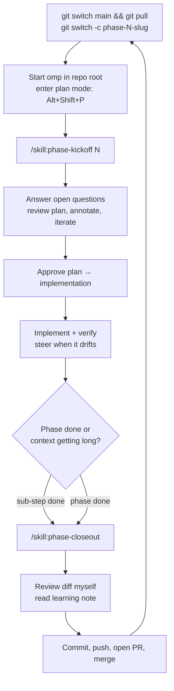

# AI Session Workflow

How to run omp sessions for the migration in [`migration-plan.md`](./migration-plan.md). The aim is that every session starts from the same written context, does one bounded piece of work, and leaves the docs accurate for the next session.

## Core principles

1. **The repo is the memory.** Chat history isn't carried between sessions. Anything a future session needs must be in `docs/migration-plan.md`, `docs/adr/`, `AGENTS.md`, or code comments.
2. **One phase (or sub-step) per session, one branch per phase.** If a session's context gets long or the work drifts, stop, close out what's done, and start fresh.
3. **Plan, then build.** Plan mode is read-only. Approving the plan switches to implementation.
4. **Verify by running things.** "Tests pass" isn't the bar. The exit criteria in the plan are things you can observe working.
5. **Close out every session**, even partial ones. Stale docs mislead every later session.

## Where context lives

|File|Loaded how|Contains|Update when|
|---|---|---|---|
|`AGENTS.md` (root)|Automatically, every session|How the repo works *today*, plus a pointer to the migration plan|Architecture, commands, or conventions change|
|`docs/migration-plan.md`|Read by the kickoff skill|Phases, status, exit criteria, open questions, phase log|Every session (status/log), and whenever scope changes|
|`docs/adr/*.md`|Read by the kickoff skill (the relevant ones)|Decisions and their rationale|A hard-to-reverse or cross-phase decision is made or changed|
|`docs/learning/phase-N-*.md`|Read by me|Walkthrough of what was built and why|At phase close-out|
|`backend/AGENTS.md`, `web/AGENTS.md` (from Phase 2/7)|Automatically, **only when omp is started from inside that directory (or deeper)**; then it loads in addition to the root file|Area-specific conventions|Conventions in that area change|

**Starting omp from a subdirectory.** omp collects `AGENTS.md` files by walking *up* from the directory it was started in to the repo root. It never looks down into subfolders. So:
- Started at the repo root (the default in this workflow): only the root `AGENTS.md` loads. Asking for changes in `backend/` doesn't load `backend/AGENTS.md`.
- Started in `backend/`: both `backend/AGENTS.md` and the root `AGENTS.md` load. The project skills in `.omp/skills/` still load, because skill discovery also walks up.
- The rule this workflow follows: **start at the repo root** for phase work, which usually spans `web/`, `backend/`, and `deploy/`. Keep area files short, and have the root `AGENTS.md` point to them ("Before changing `backend/`, read `backend/AGENTS.md`") so a root session still finds them. Start inside a subdirectory only for a session that stays entirely inside it.

Keep `AGENTS.md` describing **current reality**, not the target. The target lives in the plan. During the migration, `AGENTS.md` describes the hybrid state honestly (for example "catalog goes through `/api`; comparisons still call Supabase").

## Project skills

Two project skills live in `.omp/skills/`. They're prompt templates I invoke by name, and they save me retyping the same instructions each session:

|Skill|Invoke|Does|
|---|---|---|
|`phase-kickoff`|`/skill:phase-kickoff <phase or sub-step>`|Reads the plan and relevant ADRs, checks the git state, resolves that phase's open questions with me, then drafts a plan|
|`phase-closeout`|`/skill:phase-closeout`|Updates plan status and log, ADRs, `AGENTS.md`, and the learning note; runs checks; drafts the PR description|

**Why skills and not just docs:** the workflow rules (what to read, what to update) are the same every session, so a skill keeps them consistent without me remembering to paste them. Skill content is loaded only when invoked, so it doesn't use up context in every session the way `AGENTS.md` does.

**What not to turn into skills:**
- Project facts. They belong in `AGENTS.md`.
- Decisions. They belong in ADRs.
- One-off instructions.

Add a new skill only when I notice myself typing the same multi-step instruction for the third time. Likely future candidates:
- `new-endpoint`: OpenAPI → codegen → handler → ownership test → frontend hook
- `db-migration`: write the goose migration → rehearse on a restored backup → apply

Skills are discovered when a session starts. After editing one, start a new session (or run `/new`) to pick up the change.

## Per-session loop

### 1. Start

- `git switch main && git pull`, then `git switch -c phase-N-<slug>`. For a large phase, use one branch per sub-step: `phase-3a-items`, `phase-3b-tags`, and so on.
- Start omp from the repo root, so the root `AGENTS.md` and the project skills load.
- Enter plan mode (`Alt+Shift+P`), then run `/skill:phase-kickoff 3a` (or whichever phase or sub-step).

### 2. Plan

- The kickoff skill makes the agent read the plan and ADRs, then ask me about any open questions tagged for this phase. Answer them. Answers that are decisions turn into ADRs at close-out.
- Review the proposed plan. Things to check:
  - Does it match the phase's exit criteria?
  - Does it touch anything outside the phase's scope?
  - Does it contradict an ADR? If so, either the plan changes or a new ADR supersedes the old one. A plan never silently diverges from an ADR.
  - Is the verification real? For example: deploy and curl the endpoint, click the flow in the browser, run the restore drill.
- Use `/plan-review` to reopen the plan and annotate specific sections instead of rewriting it in chat.
- If a phase plan has more than about 8–10 distinct steps or spans several subsystems, split it into sub-steps and plan only the first.

### 3. Implement

- Approve the plan. Prefer starting implementation with fresh context if offered, because the plan file carries everything needed.
- Steer early when it drifts. Interrupting is cheaper than reverting.
- **Things to watch for:**
  - Scope creep. Unasked-for refactors, retries, or abstractions: say "out of scope, revert that".
  - Skipped verification. Ask "show me it running".
  - Ownership checks (`user_id` filtering) missing from new queries.
  - Secrets appearing in plain text anywhere outside `deploy/secrets/` (which is SOPS-encrypted).
  - Changes to generated files made by hand instead of by regenerating.

### 4. Close out

- Run `/skill:phase-closeout`. It updates the docs, writes the learning note, runs the checks, and drafts the PR text.
- **Read the diff myself before committing.** AI wrote the code; I'm the reviewer. This is also when I learn: read the learning note next to the diff, and add my own questions to it.
- Commit, push, open the PR, check CI passes, merge. Flux deploys from `main`.

### 5. Between sessions

- Mid-phase handoff: if I have to stop mid-phase, run the close-out anyway. It marks the phase 🟡 in progress, writes "next steps" into the phase log, and commits work-in-progress to the branch. The next session's kickoff picks up from there.
- If a session went badly, throw it away: `git restore` / `git reset` on the branch, note what went wrong in the plan's open questions, and start fresh. A clean restart costs less than untangling a confused session.

## Reminder prompts

Use these as-is when the agent needs a nudge:

- **Docs drift:** "Before continuing: does anything we just did change `AGENTS.md`, the plan, or an ADR? Update them now."
- **New decision:** "That's a decision a future session could re-decide differently. Write it up as ADR-NNNN using the template in `docs/adr/README.md`."
- **Contradicting an ADR:** "That conflicts with ADR-NNNN. Either follow the ADR or propose a superseding ADR. Don't silently diverge."
- **Verification:** "Show me evidence that it works end to end: run it, deploy it, or curl it, not just the unit tests."
- **Scope:** "That's outside this phase. Note it in the plan's open questions instead of doing it."
- **Learning:** "Explain the Go idiom you used in `<file>` and the alternatives you rejected. Add it to the learning note."

## Model and context hygiene

- Use a stronger model in plan mode (the `plan` model role) and the default model for implementation.
- A session that has compacted more than once is a sign the slice is too big. Close it out and start fresh.
- For broad research ("how is X used across the repo"), let the agent spawn read-only subagents (`scout`) so the main context stays small.
- Don't paste large logs. Point at files or let the agent run the command itself.

## Git and PR conventions

- Branches: `phase-N-<slug>` or `phase-Na-<slug>`. Never commit straight to `main`.
- Commits: small and descriptive. The agent can propose messages; I approve.
- PR description, drafted by the close-out skill:
  - what changed
  - how it was verified (commands and their output)
  - docs updated
  - follow-ups
- Squash-merge, so `main` has one commit per sub-step.
- Docs, ADRs, this workflow, and `.omp/skills/` are all tracked in Git. They're the shared memory between sessions, and the ADRs and learning notes double as portfolio material.
